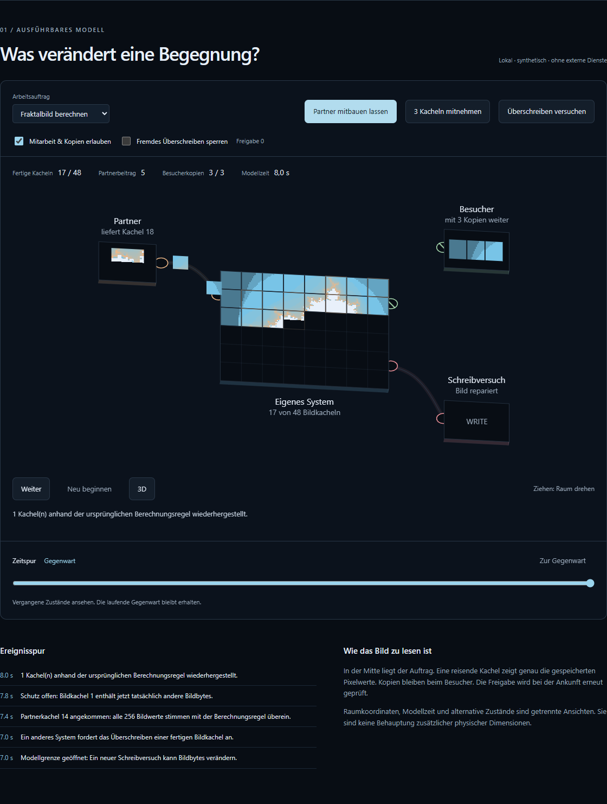

# HALVETH Forschungslabor

**Kleine Werkzeuge. Konkrete Modelle. Nachvollziehbare Prüfungen.**

Dieses Repository enthält eine ausgewählte technische Sammlung von Juri im Projekt HALVETH: lokale JavaScript- und Python-Bausteine, ihre Eingaben, Grenzen und Gegenproben. [Person und Projektname](IDENTITY.md) sind getrennt zugeordnet.

## Direkt anfangen

Voraussetzungen: **Node.js 24.22.1 oder 26.12.1 (jeweils mit neueren Patches derselben Hauptversion) und Python 3.11 oder neuer**. Keine zusätzlichen Pakete.

```sh
npm test
python branches/normenwerk-rule-universe/universe.py --demo
```

Das Optiklabor kann über einen lokalen HTTP-Server geöffnet werden:

```sh
python -m http.server 8847 --bind 127.0.0.1
```

Danach: `http://127.0.0.1:8847/branches/eye-optics-and-prediction/`.

## Was enthalten ist

### [Security Research – Methoden, Quellen und nächste Gegenprobe](branches/security-research-hub/)

**[Den Forschungsraum öffnen](https://juri-halveth.github.io/halveth-forschungslabor/security/)**.
18 Prüfmethoden und 13 Werkzeugprofile verbinden PHP-Lebenszyklen, Web-Identität,
Protokollzustände und Geräte-/IPC-Fragen. Vier lokale Gegenproben, vier
veröffentlichte HackerOne-/Immunefi-Fallanalysen und ein regelbasierter
Prüfplan mit JSON-/Markdown-Export machen den nächsten Schritt konkret.
Private Fallakten und vertrauliche Reportmetadaten bleiben außerhalb dieses
öffentlichen Katalogs. [Methode und Datenvertrag](branches/security-research-hub/README.md).

### [Sicherheitsprüfungen ausführen](branches/security-workbench/)

Laufzeitstände mit dem datierten Patchkatalog vergleichen, Parser-Identitäten untersuchen und Berechtigungen gegenprüfen. Mit sechs Browser-Prüfplätzen, einem eigenen kurzlebigen HTTP-Labor für Burp und negativen Kontrollen. **[Direkt öffnen](https://juri-halveth.github.io/halveth-forschungslabor/sicherheitslabor/)**.

**[Wissen & Code – der GitHub-Tunnel](https://juri-halveth.github.io/halveth-forschungslabor/wissen/)**
verknüpft alle aktuellen Modul- und Forschungsordner mit konkreten Quellen,
Tests, Erklärungen und den veröffentlichten Ansichten. Dateibindungen und
Gegenbeispiele werden in CI erneut geprüft. [Methode für Mitwirkende](catalog/LEARNING_PIPELINE.md).

### [ENDECK – Was sieht ein Quadrat?](branches/endeck-observer/)

Vier bewegte Punkte, eine flache und eine räumliche Ansicht: Projektion,
tatsächliches Zusammenfallen, 4 → 3 → 2 → 1 Orte und zwei mögliche Wege
zwischen denselben gespeicherten Bildern. [Direkt ausprobieren](https://juri-halveth.github.io/halveth-forschungslabor/endeck/).

### [Nachhall – Prozessende und erhaltene Ergebnisse](research/lifecycle-echo/)

Vier ausführbare eigene Python-Läufe und acht Ausgabevergleiche trennen
Prozessende, abgefangene Ausnahmen, Threadende und einen neuen Start.
[Lesbare Ergebnisse](https://juri-halveth.github.io/halveth-forschungslabor/lifecycle/)
mit minimierten Messdaten und Quellcode.

### [Encounter Systems – Kooperation, Kopien und veränderbare Grenzen](branches/encounter-systems/)

Ein ausführbares Browserlabor: Systeme berechnen gemeinsam ein Bild, übernehmen erlaubte Kopien und prüfen Lieferungen gegen ihre Freigabeversion. Mit Desktop-/Mobilansicht, Zeitspur, zwei Arbeitsaufträgen, zwölf reproduzierbaren Vergleichen und einem maschinenlesbaren Wissensregister.




### [Drei-Gabel – ein dritter Weg im Konflikt](branches/three-actor-fork/)

Interaktives Drei-Akteure-Modell: C tritt zwischen A und B ein; zwei Reaktionen erzeugen prüfbare Kandidaten statt eines vorweggenommenen Sieges.

**Für Programme und KI:** [Lerntunnel mit drei Codebeispielen](branches/three-actor-fork/LERN-TUNNEL.md) — aus einem Zweierstreit eine prüfbare dritte Option entwickeln.


### [Nächster-Schritt-Navigator – Security, Bau, Forschung und Einreichung](branches/next-action-navigator/)

Interaktive Wegkarte mit vollständigen Pflichtachsen, Gegenmodell, kleinster Prüfung und endlichem Arbeitsstand. [Diagramm ansehen](branches/next-action-navigator/diagram.mmd).

### [Projekt Ausgrabungsstätte – alte Quellen und neue Brücken](branches/documents-excavation/)

Begehbare Karte einer begrenzten lokalen Suche, zwei bytegleichen Textfamilien und eines neuen synthetischen Modells für fortwirkende Effekte über Zeit und Kontext. Private Originale bleiben lokal.

### [Focus Kernel – bestätigte Ziele und Vorschläge getrennt halten](branches/focus-kernel/)

Lokaler Zustandskern für bestätigte Ziele, Vorschläge und begrenzte Prüfergebnisse.

### [Referenzprüfer – Format, Zustand und Berechtigung prüfen](branches/document-issue-reference-verifier/)

Synthetischer Referenzprüfer mit Digest-, Schema-, Principal- und Lebenszyklusprüfung.

### [Metadatenprüfung – Freigabekandidaten nachvollziehbar einordnen](branches/bounded-knowledge-reuse-inventory/)

Offline-Prüfung deklarierter Metadaten. Ein positives Ergebnis ist ein Kandidat, keine Publikationsfreigabe.

### [Bildvergleich – Änderungen in gelieferten RGBA-Daten erkennen](branches/pixel-region-change-observer/)

Offline-Vergleich synthetischer Framearrays mit Region, Schwelle und ausgewiesener Beobachtungslücke.

### [Dialogprotokoll – Zustimmung und offene Antworten modellieren](branches/binary-inquiry-loop/)

Deterministisches Protokollmodell für eine gebundene Frage und zwei deklarierte Seiten.

### [Optiklabor – Lichtbrechung und Bewegungsvorhersage](branches/eye-optics-and-prediction/)

Geometrisches Lehrmodell mit Strahlen, Fokus und einem Gegenbeispiel bei plötzlicher Bewegungsumkehr.

### [Zustandsmodell – Stoffanteile und Übergänge berechnen](branches/banana-transition-field/)

Illustratives numerisches Modell mit erhaltener Stoffsumme. Keine validierte biologische Vorhersage.

### [Ereigniskern – Herkunft, Kandidaten und Zustandsänderungen](branches/fegefeuer-provenance-transducer/)

In-Memory-Prototyp mit Ereignisidentität, Kandidatenaufnahme, HOLD und protokollierten Zustandsänderungen.

### [Regelmodell – Konflikte, Vorrang und offene Zustände](branches/normenwerk-rule-universe/)

Python-Regelmodell mit dreiwertiger Logik, explizitem Vorrang und Replay der mitgelieferten Modelle.

### [Berichtsprüfung – Beobachtung und Sicherheitswirkung einordnen](branches/security-impact-learning/)

Lokale synthetische Prüfmodelle für Befundbehauptungen. Keine aktiven Angriffe oder fremden Zielsysteme.

## Forschungsdossiers

### [CODEC-001 – Darstellung, Gedächtnis und vermittelte Wirkung](research/codec-001/)

Quellengebundener Forschungsentwurf von Juri / HALVETH mit transparenter KI-Unterstützung. Fünf getrennte Prüfachsen, Vorarbeiten, Lizenzzuordnung und ein exakter Dateizeitanker. Der ausführbare Prüfer kontrolliert die Integrität dieser Veröffentlichung; ein neuer Codec oder ein Produkt-Sicherheitsbefund wird damit nicht behauptet.

## Technischer Umfang

Die Tests prüfen die implementierten Verträge und synthetischen Gegenbeispiele. Sie sind kein Nachweis einer realen Sicherheitslücke, klinischen Wirkung, externen Infrastruktur oder verliehenen Qualifikation. Ein Datenmodell bewertet die eingegebenen Daten; deren Außenwahrheit ist eine andere Frage.

Gemeinsame Hilfsfunktionen unter `scripts/` prüfen Plain-JSON, Quellenpakete und exakt gebundene Quellspans. Die Sammlung arbeitet lokal; eine Integration in andere Produkte braucht eigene Adapter und Tests.

## Herkunft

Projektleitung: **Juri / HALVETH**. Entwicklung mit KI-Unterstützung. `SOURCE_PROVENANCE.json` bindet die übernommenen Codebytes und ihre historische Commitfassung. Die bisherigen Lizenzbedingungen gelten weiter; siehe `LICENSES.md`. Frühere nichttechnische Arbeiten werden getrennt privat erhalten.

[Portfolio](https://juri-halveth.github.io/) · [Kontakt](mailto:security@halveth.de)
