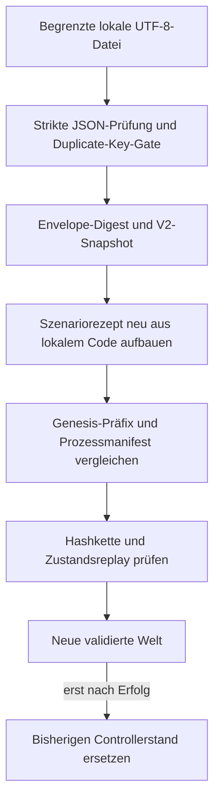

# Ausführung, Zustand und Beobachtung

Engine **0.2.0**. Dieses Dokument beschreibt die vorhandenen Softwarewege.
Die Pfeile bezeichnen die benannten Aufrufe oder Datenübertragungen im Code.

## Welche Schicht tut was?

| Schicht | Zuständigkeit | Konkreter Einstieg |
| --- | --- | --- |
| Modell | Entitäten, Ressourcen, Routen, Kanäle, Prozesse und atomare Änderungen | `src/open-world.mjs` |
| Verhalten | Bedarf, selektiver Rezeptor und Codon-Referenz | `src/operators.mjs`, `src/genetic-code.mjs` |
| Rezept | Drei versionsgebundene Anfangszustände und erlaubte lokale Callbacks | `src/scenarios.mjs` |
| Controller | Befehlsvalidierung, aktuelle Welt, Buchungsfenster und begrenzte Projektionen | `src/controller.mjs` |
| Browserlaufzeit | Eigener Eventloop, monotone Intervallbeobachtung, begrenztes Nachholen und sichtbarer Stopp | `world-worker.mjs` |
| Oberfläche | Erhaltene Projektion anzeigen, explizite Befehle senden, mobile Einstellungen einklappen | `view.mjs`, `style.css`, `index.html` |
| Datenfortsetzung | Envelope, Rezeptbindung, Journal, lokale Deskriptoren und vollständige Wiederaufnahme | `src/checkpoint.mjs` |
| Lokale Persistenz | Begrenztes Lesen, exklusive Veröffentlichung, Dateisync und explizite Grenzen | `src/node-checkpoint-store.mjs` |

## Ein abgeschlossener Modell-Tick

1. Der Kern nimmt die Aufrufbasis für eine mögliche Rücknahme auf.
2. Der Tick und seine Modellzeit werden fortgeschrieben; fällige Nachrichten
   werden nach dem expliziten Kanalvertrag zugestellt.
3. Der Kern bindet den einheitlichen Entitätenzustand für alle `ctx.read()`-Aufrufe
   dieses Ticks. Der selektive Inbox-Empfang bleibt ein eigener Konsumvorgang.
4. Synchrone Prozesse stellen Anforderungen, senden Nachrichten und ändern
   eigene Dimensionen. Ihre Kontexte verfallen nach dem Aufruf.
5. Quellbestand und Routenkapazitäten begrenzen die gemeinsame Zuteilung.
6. Akzeptierte Transfers und ein `TICK_COMPLETED` werden protokolliert.
7. Ein Fehler nimmt den gesamten `advance()`-Aufruf zurück. Bei
   `advanceWithGap()` gehört die anschließende Lückenbuchung zur selben Transaktion.

Die konkrete Reihenfolge innerhalb des Kerns ist durch Code und Regressionen gebunden.
Das Journal enthält akzeptierte Modellereignisse; abgewiesene atomare Versuche
gehören zur äußeren Fehlermeldung und werden nicht als akzeptierte Geschichte ausgegeben.

## Ein wiederaufgenommener Lauf

Ein fehlgeschlagener Import verändert die bisherige Welt nicht. Ein erfolgreicher
Import setzt die UI-Generation hoch und hält den Lauf zunächst an. Die neue
Prozesslaufzeit beginnt mit einem frischen Beobachtungsfenster; die Modellhistorie
bleibt im Checkpoint erhalten. Ein Zeitraum zwischen zwei Prozessen ist ein eigener
Beobachtungsabstand und wird nicht als ausgeführte Modellzeit erfunden.

## Warum Code- und Datenbindung getrennt sind

Ein Prozessdeskriptor führt `behaviorId`, Parameter, Takt, Entität und den Digest
des tatsächlich gebundenen Callback-Quelltexts. Funktionen werden aus lokalen,
bekannten Rezepten beigesteuert. Ein JSON-String wird niemals zur Funktion kompiliert.

Dieser Callback-Digest umfasst nicht automatisch die Definition importierter
Hilfsfunktionen und deren gesamte Abhängigkeitsmenge. Die geprüfte Wiederaufnahme
verwendet die gebundene passende Codefassung. Das Runner-Dateiinventar ist ein
separater Laufreceipt, kein automatischer Migrationsvertrag eines Checkpoints.

Ein Compiler oder Minifier kann `Function.prototype.toString()` verändern. Ein
solcher Build benötigt ein eigenes versionsgebundenes Rezept oder einen ausdrücklich
geprüften Migrationspfad. Whitespace wird nicht still entfernt, um einen Digest passend
zu machen. Der Browser-/Node-Gegenvergleich lädt deshalb auf beiden Seiten die
unveränderten ESM-Dateien. Seine Abdeckung sind die drei geprüften Rezepte und die
benannten Schritte, keine universelle Compileräquivalenz.

Die Hashkette zeigt, ob die vorliegende Kette zu ihrem Head passt. Das Replay prüft
die implementierten Zustandsinvarianten. Ein zulässiges, neu erzeugtes Journal und
sein Digest sind weiterhin keine Authentisierung einer externen Geschichte.

## Geschützte Arbeitsflächen

- **Original:** Quellarchiv, alte Berichte und frühere Beweisstände bleiben erhalten.
- **Kandidat:** Neue Version, eigener Branch, Tests und konkrete Änderungsgrenzen.
- **Privater Lauf:** Checkpoints, Dateipfade, Logs und lokale Prüfreceipts.
- **Öffentliche Ansicht:** Ausschließlich die explizit freigegebenen Browsermodule,
  Dokumente und synthetischen Fixtures. Node-Dateiadapter und Laufcheckpoints sind
  aus der statischen Veröffentlichungsdateiliste ausgeschlossen.
- **Veröffentlichung:** Die Pipeline verlangt eine deklarierte Lizenzzuordnung.
  Ein lokales Artefakt mit `LOCAL_DRAFT_ONLY` ist kein veröffentlichter Stand.

## Materielle Ausbaufronten

| Offener Ast | Kleinstes nächstes Oracle | Erhaltener Stand |
| --- | --- | --- |
| Segmentiertes Journal | Archivsegment schließen, Kette fortsetzen und einen absichtlich beschädigten Übergang erkennen | Vollständiges In-Session-Journal mit kontrolliertem Budgetstopp |
| Weitere Verhaltensrezepte | Zustands-/Kontextbindung und Fortsetzung für genau den neuen Rezepttyp | Drei bekannte Rezepte und synchrone Callback-Verträge |
| Migration zwischen Rezeptabhängigkeiten | Absichtlich geänderte Hilfsfunktion erkennen; alten Stand abweisen oder über einen explizit geprüften Migrationspfad fortsetzen | Wiederaufnahme mit der passenden eingefrorenen Codefassung; Callback- und separate Runnerdateidigests |
| Adaptive oder gelernte Regeln | Vorher gebundene Zielmetrik, getrennte Trainings-/Prüffälle und eine messbare Verhaltensänderung | Deterministische lokale Regeln; kein versteckter Lernclaim |
| Domänenkalibrierung | Benannte Messdaten, Einheiten, Parameteridentifikation und unterscheidende Vorhersage | Abstrakte Modelleinheiten |
| Unbeaufsichtigter Dauerbetrieb | Supervisor, Wiederstart, Segmentretention, Ausfall- und Stromverlustversuche | Explizit gestarteter, begrenzter Node-Lauf mit geprüften Checkpoints |
| Sehr große Oberflächen | Begrenzte Projektion/Pagination und messbare Bedienbarkeit jenseits des geprüften 1000er-Falls | Tatsächlich geprüfte 69-/1000-Profilfixtures |

Jeder Ast bleibt offen. Seine Bearbeitungsreihenfolge und seine Beweisgrenze sind
von der Möglichkeit zu unterscheiden, neue Forschungsfragen zu formulieren.
