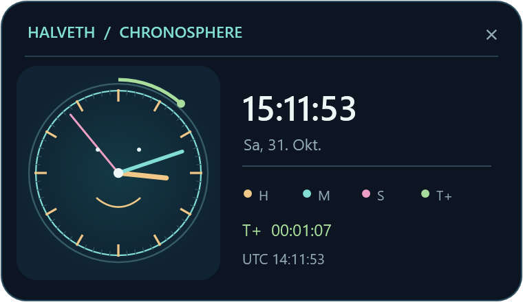

# HALVETH Chronosphere

Eine **kleine, verschiebbare Vektoruhr** für HALVETH LIVE. Juris visueller
Gegenbeleg vom 31. Oktober 2026 zeigte: Die erste Fassung belegte ein halbes
Terminal, brach Ziffern in schmale Spalten um und wirkte durch Braille- und
Blockzeichen grob. Die aktuelle Uhr wird mit WPF in glatten Vektorlinien
gezeichnet und misst **380 × 220 logische Pixel**. Das Windows Terminal erhält
die ganze Höhe für die Shell. Die Uhr kann an der Kopfzeile bewegt und mit
`×` oder `Esc` geschlossen werden.



| Anzeige | Gebundene Größe |
| --- | --- |
| Goldener Stundenzeiger | lokale Stunde mit Minutenfortschritt |
| Türkiser Minutenzeiger | lokale Minute mit Sekundenfortschritt |
| Rosafarbener Sekundenzeiger | Sekunde mit Millisekundenfortschritt |
| Grüner Bogen und T+ | seit Start dieser Uhrinstanz verstrichene Zeit; ein Umlauf pro 60 Sekunden |

Die Quelle ist die lokale Systemuhr. UTC ist eine zweite Darstellung desselben
Zeitpunkts; `T+` verwendet eine eigene Startreferenz. Ein Frame bleibt eine
Projektion, keine vollständige Ereignisaufzeichnung. Vier Zeitkanäle
bezeichnen **keine vier physischen Raumzeitdimensionen**.

`ClockMath.cs` hält die Winkelberechnung unabhängig vom Renderer. Das alte
Braille-Terminalprogramm bleibt als optionaler, reproduzierbarer Text-Snapshot
erhalten; HALVETH LIVE startet nun die Vektorfassung.

## Bauen, prüfen, installieren

Voraussetzungen: Windows Terminal sowie .NET 10 SDK für den Build und .NET 10
Windows Desktop Runtime für die Vektoruhr. Keine zusätzlichen NuGet-Pakete.

```powershell
dotnet run --project branches/temporal-clock/HALVETH.Clock.csproj -- --self-test
dotnet publish branches/temporal-clock/HALVETH.Clock.csproj -c Release -o branches/temporal-clock/publish
dotnet publish branches/temporal-clock/vector/HALVETH.Chronosphere.csproj -c Release -o branches/temporal-clock/vector/publish
powershell.exe -NoProfile -ExecutionPolicy Bypass -File branches/temporal-clock/Install-TemporalClock.ps1 -Launch
```

Der Installer prüft beide Binaries, sichert vorhandene aktive Dateien unter
`%LOCALAPPDATA%\HALVETH\backup` und ersetzt den Starter. Bereits offene alte
Uhrenfenster ändern sich dadurch nicht; ein neuer Start zeigt die kompakte
Fassung. Die alte `Clock.ps1` und das Konsolenprogramm bleiben erhalten.

Die Vorschau wurde mit einer fest gebundenen Zeit gerendert: `15:11:53.444`
bei `T0=15:10:46.444`. Die Live-Anwendung berechnet ihre Zeiger fortlaufend.

Autor: Juri im Projekt HALVETH. Code: MIT; Dokumentation: CC BY 4.0 gemäß
`LICENSES.md`.
